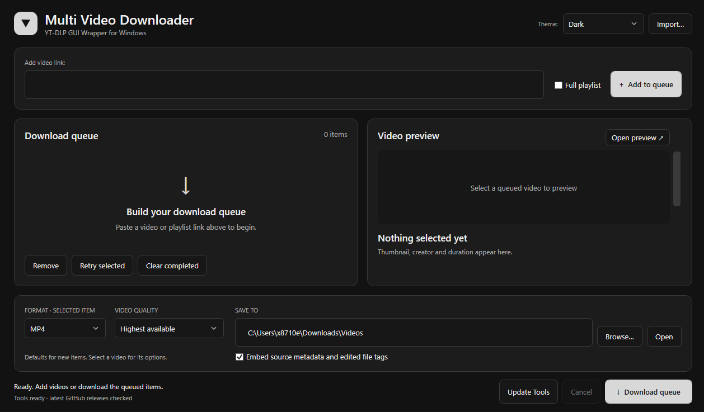
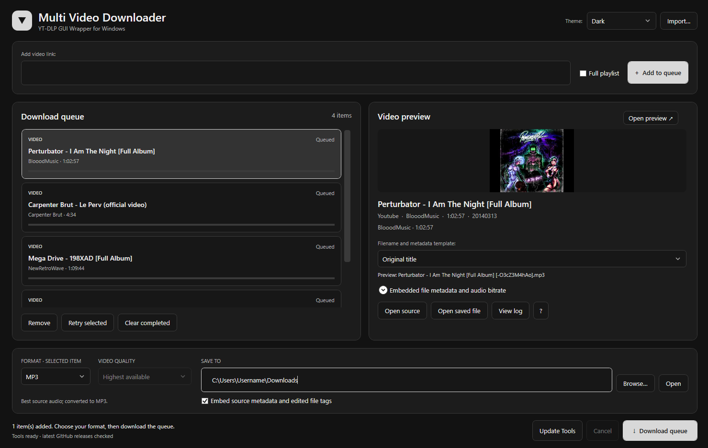

# Multi-Video Downloader



A simple yet intuitive GUI wrapper for yt-dlp to download video and audio from YouTube and over 140 supported websites.
- Windows x86/x64 desktop application written in VB.NET and WPF. 

Output formats include MP4, MKV, WebM, MP3, M4A, WAV, FLAC and Opus. Available video formats and resolutions depend on the selected source. The application supports queues, playlists, filename templates and embedded file metadata.

## Requirements

- Windows x86/x64 with .NET Framework 4.8 installed (Windows 10 and 11 should both include this out of the box)
- Visual Studio with the **.NET desktop development** workload and **.NET Framework 4.8 targeting pack**.
- An internet connection for tool installation, update checks and downloads.

## Load, edit, build and run

1. Download or clone this repository. If downloaded as a ZIP, extract it first.
2. Open `MultiVideoDownloader.sln` in Visual Studio.
3. Make any changes to the project if you choose.
4. Select **Release** and **x64**/**x86**/**ANY** in the build configuration.
5. Select **Build > Build Solution**.

The executable and its configuration are generated in `bin/Release/`. This repository contains the application source; downloaded tools and build outputs are not included but will be downloaded automatically when running the compiled binary.  Dependencies are saved in **%LocalAppData%\Programs\MultiVid**

## Run

In Visual Studio, select **Debug > Start Without Debugging** (`Ctrl+F5`), or run `bin/Release/MultiVideoDownloader.exe` after building.

On first launch, the application downloads yt-dlp, Deno and FFmpeg, including ffprobe. These tools do not need to be installed manually.

## Use

1. Paste a video link and click **Add to queue**. Enable **Full playlist** to download an entire playlist or collection.
2. Select a queued item to view its preview and choose its output format and video quality. Each item keeps its own settings.
3. Choose **Original title**, **Custom name** or **Metadata template** for its filename.
4. Choose an output folder and click **Download queue**.

Use **Cancel** to stop the current operation, **Retry selected** to retry an item, and **View log** to inspect its download log.

Website support depends on the installed version of yt-dlp and access to the source video. The application does not import browser cookies or account logins.

## Filenames and metadata

Enable **Embed source metadata and edited file tags** to write metadata inside the downloaded files. Expand **Embedded file metadata and audio bitrate** to edit fields such as Title, Artist, Album Title, Genre and Track.

In **Metadata template** mode, filename tokens and named metadata tags can be combined:

```text
{title} {Album:My Album} {Genre:Rock} {Track:1}
```

`{title}` supplies the filename. Album, Genre and Track are embedded tags; their annotations are removed from the filename. Named tags take priority over the corresponding editor fields. For playlist track numbers, use `{Track:{index}}`.

Tag support depends on the output format. For MP3, M4A and Opus, use the audio bitrate control to choose an encoding rate. Click **?** beside **View log** for metadata help if you forget.

## Tools and settings

Startup checks for tool updates every time. When running the program for the first time, it will automatically download yt-dlp, Deno, ffmpeg - you will not be able to use the GUI until these files have downloaded. On every subsequent run, it will check for updates but you can choose whether to download them or not. If the program is running as expected, you can usually carry on using the application, however it is highly recommended to keep these additional programs up to date for your own security. 

I don't accept any responsibilty/liability for your use of this software, so it's better to stay updated just in case.

Click **Tool Update Available** to install detected updates, or **Update Tools** to repair or reinstall tools. The application itself will not self-update as most of the heavy-lifting is done by yt-dlp, Deno and ffmpeg - this is merely just a useful wrapper for them.

Tools, themes, logs and settings are stored in `%LocalAppData%\Programs\MultiVid`. Queue settings are saved in `multi-video-settings.json`. Downloaded media is saved in the selected output folder.

## Example Screenshot


